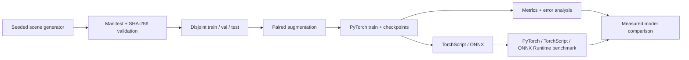

# Robotics Vision Training Pipeline

A portfolio-grade, end-to-end PyTorch semantic-segmentation project for warehouse robotics. It covers deterministic data generation, validation and leakage-safe splits; paired augmentation; configurable CPU/CUDA training; full-state checkpoint/resume; evaluation and error analysis; TorchScript/ONNX export; ONNX Runtime deployment; and measured accuracy/performance comparisons.

No dataset or pretrained model is downloaded. The bundled generator creates small RGB warehouse scenes and four-class masks (`floor`, `obstacle`, `safety_cone`, `mobile_robot`) locally. Generated data, checkpoints, and deployment artifacts are Git-ignored.

## v1.1: generalization and domain shift

The existing models now have a controlled study of lighting, texture, blur, noise,
planar viewpoint and foreground occlusion at two severities. All conditions use the
same held-out scenes and corruption seeds. Seven augmentation arms across two
models and three training seeds produced 42 measured runs and 546 evaluations.
New training transforms default to zero; the original generator/models/default
augmentation behavior and existing commands are preserved.

```bash
rv-study --study configs/ablation_smoke.yaml --output-dir runs/my_shift_smoke
rv-study --study configs/ablation_v1_1.yaml --output-dir runs/my_ablation
python scripts/review_v1_1.py --study runs/my_ablation/study.json
```

Use fresh output paths. Runs retain resolved configurations, source/transformed
hashes, all per-seed metrics, raw latency samples, and explicit failure records.
The full study uses CPU FP32, 15 epochs, data seed 17, training seeds 42/43/44 and
corruption seed 2026. Best checkpoints are selected on nominal validation only.

TinyUNet's baseline nominal mIoU is **0.6874 ± 0.1272** across seeds; LiteFCN's is
**0.6070 ± 0.0166**. Adding occlusion augmentation changes mean shifted mIoU by
**+5.73 percentage points** for TinyUNet and **−2.12 points** for LiteFCN.
These synthetic results include negative experiments and do not establish
real-world robustness. The original single-seed results remain dated historical
evidence. This checkout lacked the stated v1.0.0 tag; owner-approved `54f3a2a` is
the provisional baseline, as recorded in the audit. No baseline tag was invented.

- [Domain-shift measurements](docs/DOMAIN_SHIFT_V1_1.md)
- [Augmentation ablations, including negative results](docs/AUGMENTATION_ABLATION_V1_1.md)
- [Validation and reproduction](docs/VALIDATION_V1_1.md)
- [CPU/GPU benchmarks](docs/BENCHMARKS_V1_1.md)
- [Engineering notes and owner competency checklist](docs/ENGINEERING_NOTES.md)
- [Limitations](docs/LIMITATIONS.md), [release review](docs/RELEASE_READINESS_V1_1.md)
- [Changelog](CHANGELOG.md), [roadmap](ROADMAP.md)

## Lifecycle



Two export-friendly architectures are included:

- `tiny_unet`: skip-connected encoder/decoder with stronger spatial detail capacity.
- `lite_fcn`: depthwise-separable encoder with fewer operations and parameters.

The repository never ships invented scores. Commands below generate metrics from the current environment and write machine-readable JSON/CSV alongside provenance.

## Quick start

Python 3.10+ is required. Install the PyTorch build appropriate for your CPU or CUDA system first if the default package index is not suitable.

```bash
python3 -m venv .venv
source .venv/bin/activate
python -m pip install --upgrade pip
python -m pip install -e ".[all]"

rv-prepare --config configs/tiny_unet.yaml
rv-train --config configs/tiny_unet.yaml
rv-evaluate \
  --config configs/tiny_unet.yaml \
  --checkpoint runs/tiny_unet/checkpoints/best.pt
rv-export \
  --config configs/tiny_unet.yaml \
  --checkpoint runs/tiny_unet/checkpoints/best.pt \
  --output-dir artifacts/tiny_unet
rv-benchmark \
  --config configs/tiny_unet.yaml \
  --model artifacts/tiny_unet/model.onnx \
  --backend onnxruntime \
  --output runs/tiny_unet/benchmark_onnxruntime.json
```

For a fast integration check, replace the config with `configs/smoke.yaml`. The smoke run checks functionality; its one-epoch metrics are not a quality claim.

## Compare both architectures

```bash
rv-train --config configs/tiny_unet.yaml
rv-evaluate --config configs/tiny_unet.yaml \
  --checkpoint runs/tiny_unet/checkpoints/best.pt
rv-benchmark --config configs/tiny_unet.yaml \
  --model runs/tiny_unet/checkpoints/best.pt --backend pytorch \
  --output runs/tiny_unet/benchmark_pytorch.json

rv-train --config configs/lite_fcn.yaml
rv-evaluate --config configs/lite_fcn.yaml \
  --checkpoint runs/lite_fcn/checkpoints/best.pt
rv-benchmark --config configs/lite_fcn.yaml \
  --model runs/lite_fcn/checkpoints/best.pt --backend pytorch \
  --output runs/lite_fcn/benchmark_pytorch.json

rv-compare \
  --result tiny_unet=runs/tiny_unet/benchmark_pytorch.json \
  --result lite_fcn=runs/lite_fcn/benchmark_pytorch.json \
  --output-prefix runs/model_comparison
```

The comparison command refuses fewer than two measured files and copies values without inventing missing data.

## Resume training

Checkpoints include model, optimizer, scheduler, AMP scaler, epoch, best score, resolved configuration, DataLoader shuffle state, and Python/NumPy/PyTorch/CUDA RNG state.

```bash
rv-train --config configs/tiny_unet.yaml \
  --resume runs/tiny_unet/checkpoints/last.pt
```

Plan the final epoch count before the initial run. Exact resume rejects changes to the epoch schedule, optimizer, batch size, seeds, augmentation, workers, AMP mode, architecture, input size, class count, or manifest. CPU tests compare interrupted and uninterrupted model weights bit for bit. Cross-device or cross-version equality is not promised. Checkpoints use Python pickle for full optimizer/RNG state and must come from a trusted source.

## Configuration

YAML files inherit validated defaults from `robotics_vision.config.DEFAULT_CONFIG`. Known values can be overridden without editing a file:

```bash
rv-train --config configs/tiny_unet.yaml \
  --set training.device=cpu \
  --set training.epochs=10 \
  --set experiment.name=unet_cpu_10e
```

Unknown keys, invalid devices, empty splits, unsupported architectures, and inconsistent class counts fail early. Every run stores `resolved_config.yaml`, `environment.json`, `data_validation.json`, line-delimited events, epoch CSV, and checkpoint metadata.

## Evaluation and error analysis

Evaluation reports:

- pixel accuracy;
- per-class and macro precision/recall;
- per-class IoU and mean IoU over classes present in the evaluated ground-truth/prediction union;
- the full ground-truth-row/prediction-column confusion matrix;
- histogram-approximated one-vs-rest pixel average precision and foreground pixel mAP;
- the lowest-IoU examples as `input | ground truth | prediction` PNG panels.

Instance-detection mAP is not applicable to this semantic-segmentation task. Pixel mAP is clearly named and includes its bin count to avoid conflating the two.

## Outputs

```text
data/processed/<dataset>/
  images/ masks/ manifest.json
runs/<experiment>/
  resolved_config.yaml environment.json data_validation.json
  events.jsonl metrics.csv training_summary.json
  checkpoints/{last,best,epoch_*.pt}
  evaluation/metrics.json
  evaluation/error_analysis/{summary.json,*.png}
artifacts/<experiment>/
  model.torchscript.pt model.onnx metadata.json
```

These paths are excluded from Git because datasets and model binaries do not belong in source history.

## Quality gates

```bash
pytest
ruff check .
```

Tests cover deterministic generation, ID/path/content leakage, checksum/label validation, deterministic paired augmentation, exact metric edge cases, both model shapes, bitwise CPU resume, dynamic TorchScript/ONNX equivalence, evaluation, benchmarking, and measured comparison output. GitHub Actions runs those checks plus the complete tiny lifecycle and both architectures on CPU.

Additional tests cover paired shifts, homography/occlusion label semantics,
augmentation bounds, legacy resume defaults, repeat-study equality, nonfinite
loss/logit rejection, failure preservation and atomic study ledgers. CPU CI also
runs a four-run domain-study smoke and uploads its evidence even on failure.

## Documentation

- [Dataset card](docs/DATASET_CARD.md)
- [Training and reproducibility](docs/TRAINING.md)
- [Model card](docs/MODEL_CARD.md)
- [Export and deployment](docs/DEPLOYMENT.md)
- [Portfolio requirement map](docs/PORTFOLIO_REVIEW.md)
- [Local verification record](docs/VERIFICATION.md)
- [Technical audit report](docs/AUDIT_REPORT.md)
- [NVIDIA GPU validation](docs/GPU_VALIDATION.md)

## License

Code is MIT licensed. Scenes produced by the bundled generator are dedicated to the public domain under CC0-1.0 as recorded in every manifest. See the dataset card before substituting external data.
