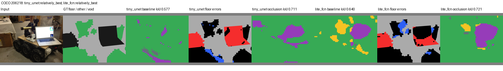
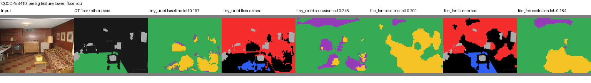

# Failure analysis v1.2

All 80 real images contribute to every numerical evaluation. No image is removed
because a model fails. [Native per-image counts](evidence/v1_2/study.json) and
[all class precision/recall](evidence/v1_2/real_runs.csv) support this analysis.

## Quantitative diagnosis

Primary64² baseline floor precision/recall by seeds 42/43/44:

| Model | Precision | Recall | Floor IoU mean ± sample SD |
| --- | --- | --- | --- |
| TinyUNet | 0.1212 / 0.1398 / 0.1337 | 0.7920 / 0.7804 / 0.7997 | 0.1271 ± 0.0087 |
| LiteFCN | 0.1291 / 0.1445 / 0.1552 | 0.7185 / 0.7931 / 0.4705 | 0.1314 ± 0.0082 |

Low precision demonstrates widespread false floor, even where recall is high.
Floor is only 2,481,044 / 20,123,139 valid pixels (12.33%). Binary mIoU averages
floor and nonfloor; a nonfloor gain can raise mIoU without meaningful floor improvement.
Baseline pixel accuracy is 0.3281 ± 0.0576 (TinyUNet) and 0.4608 ± 0.1377 (LiteFCN).
Macro precision is 0.5137 / 0.5225 and macro recall 0.5268 / 0.5467 (seed means).

Mean false-floor fraction on selected nonfloor source categories, pooled within
seed then averaged over seeds:

| Source category | TinyUNet | LiteFCN |
| --- | --- | --- |
| wall-other-merged | 78.57% | 52.13% |
| cabinet-merged | 80.06% | 65.77% |
| person | 65.23% | 61.19% |
| wall-tile | 81.70% | 51.30% |

Raw support/false-floor arrays for all source categories remain in each record.
These categories are not relabelled as mobile robots or generic obstacles.

Floor error rate within a 3-native-pixel boundary band is **0.5078 TinyUNet /
0.5027 LiteFCN**; away from boundaries it is **0.6762 / 0.5401**. Thus error is not
limited to thin boundaries. Boundary/interior class prevalence differs: this is a
diagnostic, not a controlled causal comparison. Low64² logits restored to native
resolution impose visible block/contour limits, but128² alone does not solve transfer.

## Deterministic qualitative evidence

[Selection manifest](evidence/v1_2/gallery/selection.json) includes each architecture's
baseline seed42 worst/lower-median/best floor IoU. The union also includes the lower
TinyUNet floor-IoU member of each pre-prediction input-tag pair. All panels show
both baseline and occlusion predictions for both models at 64². No arm is chosen for
its success. “Relatively best” is a rank, not a deployment acceptance threshold.
The gallery is 11 cases, with actual photo attribution or an explicit omitted-photo
placeholder; numerical predictions and ground-truth maps stay visible for all 11.

Color: floor green, obstacle gray, cone yellow, robot purple. Ground-truth binary
maps use dark nonfloor and light-gray void. Error maps: red false floor, blue missed
floor, gray void. Full four-color outputs show unsupported class confusion; there
is no compatible real cone/robot accuracy claim.

| Example | Why selected / observed failure |
| --- | --- |
| [206218](evidence/v1_2/gallery/206218.png) | Both relatively best: baseline floor IoU 0.5769 TinyUNet / 0.6397 LiteFCN. Occlusion reaches 0.7114 / 0.7213 on this one image, while scene objects still produce false floor and unsupported colors. A local success does not rescue aggregate failure. |
| [287347](evidence/v1_2/gallery/287347.png) | TinyUNet worst, floor IoU 0.0023. Original photograph stays local because creator lookup is unresolved; GT/prediction/errors retained. |
| [498919](evidence/v1_2/gallery/498919.png) | LiteFCN worst, floor IoU 0.0000; fruit/market structure does not yield correct floor recognition. |
| [256916](evidence/v1_2/gallery/256916.png) / [333772](evidence/v1_2/gallery/333772.png) | Median cases and clutter/desk objects; extensive false floor on nonfloor objects. |
| [464358](evidence/v1_2/gallery/464358.png) | Dark interior/window lighting example: floor IoU 0.031/0.067. No calibrated illumination or noise measurement; photograph omitted from tracked panel because attribution lookup fails. |
| [343466](evidence/v1_2/gallery/343466.png) | Window contrast/shadow example; source inspected before prediction. Thumbnail ID 343468 was transcribed incorrectly and corrected explicitly to 343466. |
| [458410](evidence/v1_2/gallery/458410.png) | Textured floor/walls/furniture: many wall/couch regions become floor or unsupported object classes; occlusion helps TinyUNet locally and hurts LiteFCN locally. |
| [383842](evidence/v1_2/gallery/383842.png) | People/furniture partially obscure floor; models label large person/object regions as floor. No claim to recover hidden floor. |
| [554291](evidence/v1_2/gallery/554291.png) | Visible blur/moving animal and clutter; floor IoU 0.013/0.007. This is qualitative blur, not a measured PSF or an isolated blur intervention. |
| [68765](evidence/v1_2/gallery/68765.png) | Oblique desk/keyboard view, floor IoU 0.043/0.090; viewpoint and object/domain appearance co-occur, so no viewpoint-only causal claim. |

Photo credits, source links, licenses and resizing modifications:
[ATTRIBUTION.md](evidence/v1_2/gallery/ATTRIBUTION.md). COCO Consortium annotations
are CC BY 4.0; nine photos have recovered public creator credits and source-metadata
CC BY 2.0. Two photos remain local rather than being redistributed without creator
attribution. All 80 originals still have recorded dataset license IDs and hashes.
Input tags were agent visual observations, not human-certified ground truth or
exhaustive condition labels. Initial Flickr lookup URL failures and the thumbnail
ID typo are retained in the operational record; neither excludes numerical cases.

## Interpretation and next diagnostics

The evidence shows widespread semantic errors and architecture/seed-sensitive
augmentation effects. Palette shortcuts, training BatchNorm statistics, impoverished
synthetic scene structure and ontology/distribution mismatch are plausible mechanisms.
They remain **hypotheses**: no intervention isolates them. A next study needs
representative warehouse labels and separate tuning/test scenes before adaptation,
plus boundary/support diagnostics and scene uncertainty. Do not tune on these 80
final-test photographs while presenting them as an independent benchmark.

## Owner competency checklist

- [ ] Explain low floor precision with high recall and the role of class prevalence.
- [ ] Distinguish observed co-occurring failure conditions from isolated causal experiments.
- [ ] Recompute one panel's metric and locate unsupported-class/void handling.
- [ ] Explain why a best example and a mean improvement cannot justify robot deployment.
